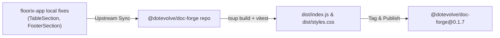

# Design Specification: DocForge v0.1.7 Sync & Release

## 1. Architecture Overview
This release reconciles recent document rendering and table layout fixes from `floorix-app` into `@dotevolve/doc-forge`.



---

## 2. Component Updates

### 2.1 TableSection Attribute Deduplication (`src/sections/TableSection.tsx`)
In tabular reports with multi-item or grouped structures (such as size rows under an article/item), consecutive rows with the same group key suppress repeating metadata cells according to DataDoc schema conventions:

```tsx
// 1. Determine effective grouping key:
// Priority order: explicit section.groupKey -> heuristic 'article' column -> columns[0].key
const effectiveGroupKey =
  (section as any).groupKey ||
  (columns.some((c) => c.key === 'article') ? 'article' : columns[0]?.key);

// 2. Determine suppression eligibility
const isColEligibleForBoolSuppression = !isNumericCol(col, row[col.key]);
const isSectionSuppressed =
  (section.suppressDuplicates === true && isColEligibleForBoolSuppression) ||
  (Array.isArray(section.suppressDuplicates) &&
    (section.suppressDuplicates.includes(col.key) ||
      (section.suppressDuplicates.includes('__merged') && isColEligibleForBoolSuppression)));
const isColSuppressed = Boolean(col.suppressDuplicates);
const suppressionActive =
  section.suppressDuplicates !== false &&
  (isSectionSuppressed || (section.suppressDuplicates === undefined && isColSuppressed));

// 3. Parent group match
let parentGroupMatch = true;
if (suppressionActive && rIdx > 0 && effectiveGroupKey && col.key !== effectiveGroupKey) {
  parentGroupMatch =
    String(row[effectiveGroupKey] ?? '') === String(rows[rIdx - 1]?.[effectiveGroupKey] ?? '');
}

// 4. Suppress duplicate cell value
const isDupSuppressed =
  suppressionActive &&
  rIdx > 0 &&
  parentGroupMatch &&
  row[col.key] !== undefined &&
  row[col.key] !== null &&
  String(row[col.key]) === String(rows[rIdx - 1][col.key]);

const cellValue = isDupSuppressed ? '' : String(row[col.key] ?? '—');
```

### 2.2 Footer & Page Break Synchronization (`src/sections/FooterSection.tsx`)
Ensure signature areas, date stamps, and summary grand totals avoid orphan breaks using CSS `break-inside: avoid`.

### 2.3 Barrel Exports (`src/index.ts`)
Add missing exports for studio components:
```ts
export * from './DocumentStudio';
export { DocumentStudio as DocForgeStudio } from './DocumentStudio';
```

---

## 3. Build & Packaging Pipeline
- `tsup.config.ts`: Generates ESM (`dist/index.mjs`), CJS (`dist/index.js`), and types (`dist/index.d.ts`).
- CSS Extraction: Compiles print utility classes and sheet geometries to `dist/styles.css`.
- Verification of `contrib/jobSlipAdapter.ts` compatibility with updated `TableSection`.
- Package version bumped to `0.1.7` in `package.json`.
